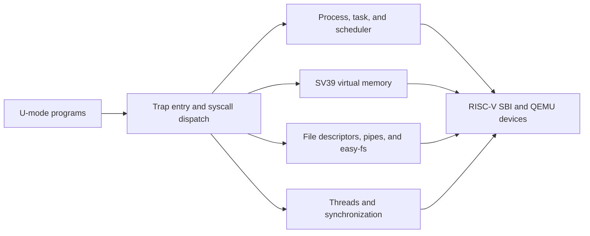

# rCore on RISC-V

An implementation-focused operating systems project built on the
[rCore-Tutorial-Code-2025S](https://github.com/LearningOS/rCore-Tutorial-Code-2025S)
teaching kernel. The work covers protected-mode execution, virtual memory,
process scheduling, filesystem semantics, threads, and synchronization for
RISC-V 64-bit systems.

This repository is organized as a technical portfolio. It keeps the original
chapter-by-chapter development history and exposes each lab result on its own
branch, so reviewers can inspect both the implementation and the decisions
behind it.

> **Scope.** This is an educational kernel, not a production operating system.
> The lab-specific extensions described below were implemented on top of the
> course-provided skeleton. Shared boot, trap, driver, and upstream framework
> components remain part of the rCore teaching codebase.

## What the project covers

- **RISC-V systems programming:** `no_std` Rust, S-mode kernels, U-mode programs,
  trap entry/exit, SBI calls, and QEMU-based execution.
- **Virtual memory:** SV39 page tables, address translation, permission checks,
  user-buffer access across page boundaries, and `mmap`/`munmap`.
- **Process management:** ELF loading, process creation, parent-child lifecycle,
  POSIX-style wait handling, and stride scheduling.
- **Storage and IPC:** virtio block devices, the `easy-fs` on-disk format,
  file descriptors, pipes, hard links, unlink semantics, and file statistics.
- **Concurrency:** threads, mutexes, semaphores, condition variables, and a
  request-time resource-safety check for deadlock detection.

## Lab implementation map

| Lab | Branch | Focus | Selected implementation work |
| --- | --- | --- | --- |
| 1 | [`ch3`](../../tree/ch3) | Traps and observability | Per-task, per-syscall call counters; `SYS_trace` byte read/write and current-task count query; user-pointer handling |
| 2 | [`ch4`](../../tree/ch4) | Virtual memory | `SYS_get_time` with cross-page user buffers; aligned `SYS_mmap`/`SYS_munmap`; protection validation; partial range unmapping by splitting map areas |
| 3 | [`ch5`](../../tree/ch5) | Processes and scheduling | Direct ELF-based `SYS_spawn`; `SYS_set_priority`; stride-based ready-queue selection |
| 4 | [`ch6`](../../tree/ch6) | Filesystem semantics | Inode link counts; `SYS_linkat`; `SYS_unlinkat`; `SYS_fstat`; file-descriptor initialization fixes |
| 5 | [`ch8`](../../tree/ch8) | Threads and synchronization | Request-time mutex/semaphore safety checks using available/allocation/need matrices; unsafe requests return `-0xDEAD` |

`ch1` and `ch2` contain the foundational kernel stages. `ch7` is the course
baseline used for the later IPC/signals chapter and does not add a separate
assessed implementation in this snapshot.

## Architecture



The kernel runs in supervisor mode, switches to user mode with `sret`, and
returns through a shared trap path for syscalls, page faults, timer interrupts,
and illegal instructions. Process and thread state is tracked through
`ProcessControlBlock` and `TaskControlBlock` objects; scheduling hands control
between tasks with a saved `TaskContext`.

## Selected engineering work

### Cross-page-safe system interfaces

`SYS_get_time` writes a `TimeVal` through the current process's page table
instead of assuming one physically contiguous user buffer. This extends the
direct user-pointer access used by the earlier tracing lab to the virtual-memory
model introduced in this stage.

### Range-aware virtual memory

`SYS_mmap` checks page alignment, protection flags, and overlapping mappings.
`SYS_munmap` validates the requested range and can split an existing
`MapArea` when only its middle section is removed.

### Direct process creation and weighted scheduling

`SYS_spawn` creates a new address space directly from an ELF image, avoiding
the cost and extra address-space copy of emulating `fork` followed by `exec`.
The scheduler chooses the task with the smallest stride value and increases
that task's stride according to its configured priority.

### Filesystem lifetime management

Hard links share one inode through an `nlink` reference count. Unlinking removes
the directory entry, decrements the count, and reclaims inode and data blocks
only after the final link disappears. `SYS_fstat` exposes inode identity, mode,
and link count to user programs.

### Request-time deadlock detection

The synchronization layer maintains per-process resource matrices for mutexes
and semaphores. Before blocking on a resource, it simulates a request against
the available resources and checks whether every thread can still complete.
Rejected requests are rolled back and reported to user space.

## Review guide

Useful starting points for a short code review:

| Topic | File |
| --- | --- |
| Syscall tracing | [`ch3: os/src/syscall/process.rs`](../../tree/ch3/os/src/syscall/process.rs) |
| Virtual memory ranges | [`ch4: os/src/mm/memory_set.rs`](../../tree/ch4/os/src/mm/memory_set.rs) |
| Process spawn and priority | [`ch5: os/src/task/task.rs`](../../tree/ch5/os/src/task/task.rs) |
| Stride scheduling | [`ch5: os/src/task/manager.rs`](../../tree/ch5/os/src/task/manager.rs) |
| Hard links and unlink | [`ch6: easy-fs/src/vfs.rs`](../../tree/ch6/easy-fs/src/vfs.rs) |
| Deadlock safety checks | [`ch8: os/src/task/process.rs`](../../tree/ch8/os/src/task/process.rs) |

For a narrative overview of the design, tradeoffs, and lab-by-lab scope, see
[Project Overview](docs/PROJECT_OVERVIEW.md).

## Build and run

The original project targets RISC-V 64-bit QEMU with the toolchain pinned in
`rust-toolchain.toml`. You also need `qemu-system-riscv64`, Rust components for
the RISC-V target, and the course user-program test suite.

```bash
git clone <repository-url>
cd <repository-name>

git switch ch8
git clone https://github.com/LearningOS/rCore-Tutorial-Test-2025S.git user

cd os
make run
```

Change `ch8` to `ch3`, `ch4`, `ch5`, or `ch6` to inspect another assessed lab.
The user test suite is intentionally ignored by Git and must be cloned
separately.

## Development history

The repository preserves the original author history, merge commits, lab
reports, and chapter branches. `main` is the portfolio landing page; kernel
source for each stage lives on its corresponding branch. The chapter sequence
is intentionally preserved rather than flattened into a single squashed
snapshot.

## Provenance and license

This project is derived from
[LearningOS/rCore-Tutorial-Code-2025S](https://github.com/LearningOS/rCore-Tutorial-Code-2025S)
and the public
[rCore tutorial book](https://rcore-os.github.io/rCore-Tutorial-Book-v3/).
The history retains commits from the upstream maintainers and other
contributors. The repository is distributed under the
[GNU General Public License v3.0](LICENSE).
