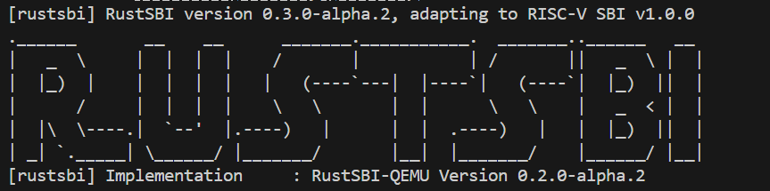
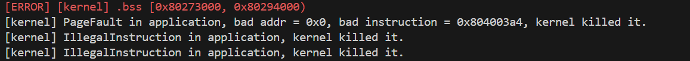

## Lab1 实验报告
周轻扬 计24 2022012166
#### 实现功能：
1. 为每个TaskManager的TaskManagerInner中新增变量`task_sys_call_cnt`，该变量为BTreeMap<usize, BTreeMap<usize, u32>>类型，即二重键值对嵌套，外层键表示task_id，内层键表示syscall_id，支持通过Task ID -> Syscall ID -> Count的方式查找指定任务中指定系统调用的调用次数。
2. 为TaskManager实现`update_syscall_cnt`方法，将当前活跃任务中id=syscall_id的系统调用次数+1，更新task_sys_call_cnt
3. 在sys_call中调用update_syscall_cnt，每次系统调用更新task_sys_call_cnt
4. 实现新系统调用`sys_trace`，依据trace_request的不同值分别实现读、写、查询当前活跃任务中id=syscall_id的系统调用次数 三种功能

#### 问答题
1. 正确进入 U 态后，程序的特征还应有：使用 S 态特权指令，访问 S 态寄存器后会报错。 请同学们可以自行测试这些内容（运行 三个 bad 测例 (ch2b_bad_*.rs) ）， 描述程序出错行为，同时注意注明你使用的 sbi 及其版本。
答：sbi版本：RustSBI version 0.3.0-alpha.2

出错行为：
- 错误1：[kernel] PageFault in application, bad addr = 0x0, bad instruction = 0x804003a4, kernel killed it.由于用户程序访问0x0，为非法地址，产生了缺页异常
- 错误2：[kernel] IllegalInstruction in application, kernel killed it.由于用户程序在U态下执行了S态下的指令sret，为非法指令
- 错误3：[kernel] IllegalInstruction in application, kernel killed it.由于用户程序在U态下执行了S态下的指令csrr，访问了S态下寄存器sstatus，为非法指令

2. 深入理解 trap.S 中两个函数 __alltraps 和 __restore 的作用，并回答如下问题:

   1. L40：刚进入 __restore 时，sp 代表了什么值。请指出 __restore 的两种使用情景。
    答：sp代表了内核栈中保存的Trap上下文（TrapContext）的起始地址。__restore用于从S态切换至U态的过程中，例如，当发生系统调用ecall时从__trap_handler中返回；当发生任务切换时从__switch中返回
   2. L43-L48：这几行汇编代码特殊处理了哪些寄存器？这些寄存器的的值对于进入用户态有何意义？请分别解释。
      ```
      ld t0, 32*8(sp)
      ld t1, 33*8(sp)
      ld t2, 2*8(sp)
      csrw sstatus, t0
      csrw sepc, t1
      csrw sscratch, t2
      ```
    答：特殊处理了sstatus、sepc、sscratch三个寄存器。
    - sstatus：保存发生特权级切换前的特权级，便于在trap处理之后恢复特权级
    - sepc：保存发生特权级切换前下一条要执行的指令的pc值，便于在trap处理之后cpu能从正确的位置继续执行程序
    - sscrach：保存用户态栈指针sp，便于在trap处理后回到U态时恢复用户栈指针
   3. L50-L56：为何跳过了 x2 和 x4？
      ```
      ld x1, 1*8(sp)
      ld x3, 3*8(sp)
      .set n, 5
      .rept 27
         LOAD_GP %n
         .set n, n+1
      .endr
      ```
      答：
      - 因为x2（sp）此时指向内核栈中的TrapContext的起始地址（sp是内核栈栈顶指针），而其应该恢复的值为用户栈栈顶指针，该值存储在sscrach中。由于当前仍需依赖内核栈栈顶指针sp恢复其他寄存器，因此必须等其他寄存器都恢复完之后，再通过`csrrw sp, sscratch, sp`将sp设置为用户栈指针，即将sp恢复为正确值，确保所有寄存器值正确切换。
      - x4为tp，是线程寄存器，一般不会用到
   4. L60：该指令之后，sp 和 sscratch 中的值分别有什么意义？
      ```
      csrrw sp, sscratch, sp
      ```
      答：该指令交换了sp和sscrach的值，交换后sp值为用户栈栈顶地址，sscrach值为内核栈栈顶地址
   5. __restore：中发生状态切换在哪一条指令？为何该指令执行之后会进入用户态？
   答：发生在sret指令，因为该指令会将当前特权级按照sstatus寄存器的SPP字段进行设置，实现S态到U态的状态切换；同时会将pc设置为sepc。从而继续从返回用户态后要执行的下一条指令处执行程序
   6. L13：该指令之后，sp 和 sscratch 中的值分别有什么意义？
      ```
      csrrw sp, sscratch, sp
      ```
      答：该指令交换了sp和sscrach的值，交换后sp值为内核栈栈顶地址，sscrach值为用户栈栈顶地址
   7. 从 U 态进入 S 态是哪一条指令发生的？
      是执行系统调用的ecall指令


#### 荣誉准则
1. 在完成本次实验的过程（含此前学习的过程）中，我曾分别与 以下各位 就（与本次实验相关的）以下方面做过交流，还在代码中对应的位置以注释形式记录了具体的交流对象及内容：
无

1. 此外，我也参考了 以下资料 ，还在代码中对应的位置以注释形式记录了具体的参考来源及内容：
实验文档<https://learningos.cn/rCore-Tutorial-Guide-2025S/chapter3>

1. 我独立完成了本次实验除以上方面之外的所有工作，包括代码与文档。 我清楚地知道，从以上方面获得的信息在一定程度上降低了实验难度，可能会影响起评分。

2. 我从未使用过他人的代码，不管是原封不动地复制，还是经过了某些等价转换。 我未曾也不会向他人（含此后各届同学）复制或公开我的实验代码，我有义务妥善保管好它们。 我提交至本实验的评测系统的代码，均无意于破坏或妨碍任何计算机系统的正常运转。 我清楚地知道，以上情况均为本课程纪律所禁止，若违反，对应的实验成绩将按“-100”分计。